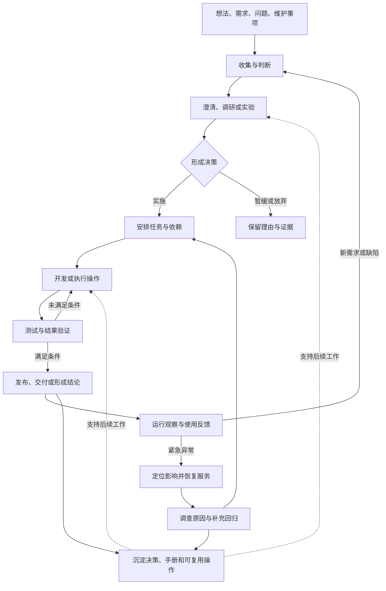

# 开发工作流设计草案

> 本文沉淀个人开发工作流的初步构想，用于持续讨论、试用和调整。文中的流程、命令和工具组合均为设计建议，尚未实现或配置。
>
> 核心问题：从一个想法或问题开始，如何组织工作、衔接行动、验证结果、交付运行，并将反馈转化为下一轮改进？

## 1. 目标与已知条件

希望串联需求管理、任务管理、代码管理、Git 管理、CI/CD 构建发布、测试管理、服务器运维与问题定位，同时考虑日常操作复用、上下文衔接和知识积累。

| 已确认条件 | 对设计的影响 |
| --- | --- |
| 个人开发为主，兼顾少量协作 | 操作成本要低；优先减少重复记录、等待和上下文切换 |
| 主要使用 Java | 构建、测试和运行方式需要适配 Java 项目，具体框架与构建工具待定 |
| 使用自建 GitLab | 可以先利用现有代码、任务和流水线能力承载试点 |
| 服务器为 Linux + Docker | 发布与诊断需要关联主机、容器、应用版本和配置 |
| 任务工具尚未确定 | 工作组织方式先作为可调整方案，避免提前绑定一种工具 |
| 凭据需要自建并完全控制数据 | 将获取凭据纳入执行能力，具体方案单独细化 |

第一版希望达到的效果：知道当前最值得做什么；开始工作时能拿到上下文；操作结束后能留下证据；出现问题时能沿关联关系定位；完成的经验能够复用。

## 2. 设计视角：工作有多种入口和完成方式

系统边界覆盖“工作进入 → 判断与组织 → 执行 → 验证 → 交付或形成结论 → 反馈与积累”。

输入可能来自新想法、用户需求、代码问题、线上告警、依赖升级或日常维护。输出可能是上线功能、恢复的服务、一个技术决策、一份调查结论，或被明确放弃的方案。

因此，流程需要容纳几类不同路径：

| 工作类型 | 常见路径 | 完成的依据 |
| --- | --- | --- |
| 探索与调研 | 问题 → 假设 → 调研或实验 → 决策 | 有证据支持结论，明确下一步或停止条件 |
| 功能交付 | 需求 → 任务 → 实现 → 验证 → 发布 → 验收 | 达成事先约定的业务结果 |
| 缺陷修复 | 现象 → 复现 → 修复 → 回归 → 交付 | 原问题消失，并有适当的回归覆盖 |
| 紧急故障 | 确认影响 → 恢复服务 → 验证 → 调查 → 改进 | 服务恢复；未解决事项已转为可追踪行动 |
| 日常维护 | 计划或触发 → 执行 → 检查 → 记录 | 达到维护目标，并确认系统状态正常 |

任务粒度和记录量随工作的复杂度调整。一个小修复可以用一条记录承载；涉及多个项目的需求则需要拆分和关联。



## 3. 串联的基础：对象及其关联

工作流需要让“为什么做、正在做什么、改了什么、验证了什么、交付到哪里”能够互相追溯。

| 对象 | 最少需要表达的信息 | 典型关联 |
| --- | --- | --- |
| 目标或需求 | 背景、期望结果、范围、验收条件 | 任务、设计决策、反馈 |
| 任务或工作项 | 当前动作、状态、依赖、下一步、完成条件 | 需求、项目、变更、验证结果 |
| 项目或服务 | 仓库、启动方式、依赖、环境、维护入口 | 多个需求、任务和发布 |
| 代码变更 | 修改内容、原因、提交与 MR | 工作项、测试、制品 |
| 验证记录 | 验证对象、版本、方法、结果、未覆盖事项 | 需求条件、变更、环境 |
| 制品与发布 | 制品标识、配置版本、目标环境、结果、恢复方式 | 代码、测试、多个工作项 |
| 故障或运行事件 | 影响、时间线、当前版本、证据、处置结果 | 发布、服务、缺陷与改进行动 |
| 知识与决策 | 结论、适用条件、依据、失效条件 | 具体项目、任务和事件 |

这些是概念对象，不要求每种对象都新建一个系统或表单。可以由 Issue、Markdown 文档、Git 记录、流水线和部署记录共同承载。

关联应允许多对多：一个需求可能涉及多个仓库；一个 MR 可以解决几个相关任务；一次发布可以包含多个需求；同一任务也可能经历多次部署。

交付路径上的追溯示例：

```text
需求 / 任务
  ↔ 分支、提交、MR
  ↔ 测试结果与流水线
  ↔ 镜像 digest
  ↔ 配置版本与部署记录
  ↔ 环境、日志、故障与反馈
```

统一关联规则比统一存储位置更重要。编号需要带上项目或仓库上下文，避免多个项目的 `#42` 混淆。

## 4. 状态、事实和知识分别表达什么

- **状态**表达当前判断，例如任务进行中、等待验收、受到阻塞。
- **事实**表达已经发生的事情，例如某次测试失败、某个镜像部署成功。
- **知识**表达可复用的理解，例如技术决策、排障方法、操作手册。

状态应能找到事实依据；知识应保留适用条件。每类信息确定一个主要维护位置，其他位置通过链接引用，减少重复维护。

候选承载方式：GitLab 保存任务、代码、MR 和流水线事实；项目仓库保存随代码演进的测试、脚本与运行手册；Obsidian 保存跨项目的思考、方法和复盘。具体工具选择可以调整。

任务状态可以先简化为：

```text
待澄清 → 可开始 → 进行中 → 待验证 → 完成
                         ↖ 验证失败 ↙

附加信息：阻塞原因、等待对象、下一步、暂缓或取消理由
```

发布状态单独记录，例如“已构建 → 测试环境已部署 → 已验收 → 生产已部署 → 运行验证通过”。这样可以表达任务与版本之间的多对多关系。

对于需要上线的功能，合并代码、流水线成功、部署成功和业务完成分别代表不同事实。探索任务则可以在结论被验证后完成。

## 5. 环节如何交接

每次交接回答五个问题：带着什么进入、执行什么、留下什么、什么条件下继续、失败后回到哪里。

| 环节 | 进入时需要 | 主要产物 | 下一步的条件或失败去向 |
| --- | --- | --- | --- |
| 需求整理 | 问题、背景或想法 | 目标、范围、验收条件、未知项 | 可以实施则拆分；未知项影响决策则先探索 |
| 任务组织 | 明确目标与约束 | 可执行任务、依赖与优先级 | 上下文与依赖足够后开始；缺失项标为阻塞 |
| 代码开发 | 任务、相关代码与验证方法 | 实现、测试、变更说明 | 自测后提交评审；发现需求歧义则回到澄清 |
| Git 与代码集成 | 可解释的变更 | 提交历史、MR、集成版本 | 检查与评审通过后合并；失败返回修改 |
| 测试验证 | 验收条件与具体版本 | 测试证据、缺陷、未覆盖范围 | 满足条件后交付；失败关联回任务或缺陷 |
| 构建发布 | 经验证的版本与配置 | 固定制品、部署记录、检查结果 | 环境与业务检查通过后推进；失败进入恢复流程 |
| 运行维护 | 环境状态、版本与观测信息 | 诊断证据、处置结果、后续行动 | 验证恢复后结束处置，遗留问题进入工作队列 |

代码管理关注结构、依赖、规范、接口和质量；Git 管理关注变更如何隔离、解释、审查、合并和追溯。两者共同服务于“可理解、可验证、可恢复的变更”。

## 6. 联动机制：由事件触发下一步

先利用现有工具的事件和记录建立关联，再按实际需要补充脚本或 API 调用。

| 触发事件 | 可以自动衔接的工作 | 需要作出的判断 |
| --- | --- | --- |
| 开始任务 | 汇集上下文、检查环境、准备分支或工作区 | 目标是否明确，当前是否值得做 |
| 提交 MR | 关联任务、运行检查与测试、汇总结果 | 实现是否符合意图，变更是否容易维护 |
| 代码合并 | 构建镜像、记录来源、部署测试环境 | 是否满足发布准备条件 |
| 测试环境验证完成 | 汇集验收证据、生成发布说明 | 是否进入生产发布 |
| 生产发布完成 | 健康检查、记录版本、更新关联信息 | 业务结果是否满足验收条件 |
| 出现线上异常 | 关联当前版本、收集诊断证据、匹配操作手册 | 影响程度、恢复策略及后续调查方向 |
| 工作结束 | 汇总结果、归档链接、提取重复操作 | 哪些经验值得沉淀，哪些流程需要调整 |

自动化执行失败时，要保留失败位置与可重试入口。重试应避免重复部署、重复创建任务或重复发送通知。任务状态同步失败与实际发布失败应分别记录。

## 7. 测试、发布和运维形成反馈循环

### 测试贯穿整个过程

- 需求阶段：明确正常路径、边界条件和异常行为。
- 开发阶段：通过单元测试与必要的集成测试尽早反馈。
- 集成阶段：验证相关模块或服务的协作。
- 发布阶段：执行冒烟检查与关键业务验证。
- 故障之后：把复现条件转为合适的回归测试，或补充监控与操作约束。

测试结果应关联具体代码、制品或部署版本。测试管理还需要记录测试数据、环境条件和暂未覆盖的风险。

### 发布保留可追溯的交付记录

建议让同一制品经过测试后晋级生产，配置通过环境区分。一次发布至少记录制品标识、配置版本、关联工作项、目标环境、检查结果和恢复方式。

发布入口需要处理并发和先后顺序，防止旧任务覆盖新版本。数据库迁移、外部副作用与配置兼容性会影响恢复条件，应在发布前说明。

### 运维从当前环境反查变更

定位问题时，先确认影响范围和当前运行版本，再查看最近变更、应用日志、资源状态和依赖情况。紧急故障可以先采取有依据的恢复措施，随后补齐时间线、根因调查和改进行动。

运行记录应支持两种查询：从发布找到相关异常；从异常找到当前版本及候选变更。故障可能来自代码、配置、数据、资源或外部依赖，调查入口需要保留这些方向。

备份、恢复演练、证书更新、依赖升级和容量维护可以作为周期性工作进入同一工作队列。是否调度自动执行，在落地时逐项确定。

## 8. 个人日常工作如何运转

个人工作流还需要覆盖每天如何选择、开始、切换和收尾。

1. **收集**：想法、缺陷、维护事项先进入一个可回看的入口，保留来源。
2. **整理**：判断价值、紧急程度与不确定性，决定实施、探索、暂缓或放弃。
3. **选择**：优先推进已有工作到可验证结果，再结合优先级安排新任务。
4. **开始**：恢复目标、代码位置、环境、验证方法和上次停止位置。
5. **切换**：记下当前结果、未解决问题和下一步，降低下次恢复成本。
6. **收尾**：确认结果，关联证据，更新状态，留下必要知识。

多项目场景下，需要一个跨项目的待办与进行中视图，以及各项目内部的详细上下文。全局视图负责选择下一步，项目视图负责执行。

先观察同时进行的任务数、待验证变更的积压和中断频率，再决定工作量限制。可以从“一个主要开发任务，同时保留处理紧急事项的空间”开始试用。

## 9. 复用能力如何从工作流中长出来

脚本和模板围绕反复出现的操作提炼。候选入口如下，名称仅用于表达意图：

| 候选入口 | 预期衔接的动作 |
| --- | --- |
| `flow start <工作项>` | 读取目标与上下文 → 准备工作区 → 记录开始 |
| `flow check` | 环境检查 → 静态检查 → 测试 → 汇总证据 |
| `flow submit` | 汇总变更 → 创建或更新 MR → 关联工作项 |
| `flow release <版本> <环境>` | 校验制品与条件 → 部署 → 验证 → 记录结果 |
| `flow diagnose <服务> <环境>` | 获取版本与状态 → 收集证据 → 指向诊断路径 |
| `flow rollback <发布记录>` | 检查恢复条件 → 执行恢复 → 验证与记录 |
| `flow resume <工作项>` | 恢复上次进度、上下文和下一步 |

项目特有的操作放在项目中；经过多个项目验证的通用操作再抽取复用，并固定使用版本。本地与 CI 尽量调用相同的构建、测试和部署实现。

凭据获取、环境配置、超时、错误处理和日志记录属于执行支撑能力。入口根据项目、环境和身份获取必要配置，避免每次手工查找。具体凭据产品及轮换机制留在专项设计中细化。

AI 可以参与需求澄清、上下文整理、编码、测试建议、诊断与文档更新。其参与位置、可执行动作和结果验证方式，应与相应工作类型一起确定。

## 10. 用三个场景检验方案

### 场景 A：交付一个功能

“增加订单导出”进入收集箱，澄清导出范围、权限和大数据量行为；拆分任务并定义验证方法。开发形成 MR，测试通过后构建镜像；在测试环境验收，将同一制品发布生产；验证业务结果后完成需求，保留测试与发布链接。

若出现大数据量超时，则关联当前版本和复现条件，进入缺陷处理，并增加对应的回归覆盖。

### 场景 B：技术方向尚未确定

“导出是否需要异步任务”先作为探索工作。列出需要回答的问题，设计最小实验，记录耗时、资源与复杂度，形成采用或暂缓的决策。结论能够支持下一步行动时，探索可以完成；后续实现另行安排。

### 场景 C：线上服务突然不可用

先确认受影响服务与最近变更，收集必要证据并选择恢复方式。恢复后验证业务路径，记录处置时间线。对于未解释的问题，建立调查任务；对于已确认原因，补充修复、监控、测试或手册。

三个场景共享关联、证据和上下文能力，执行顺序与完成条件可以不同。

## 11. 分阶段验证与持续改进

| 阶段 | 要验证的事情 | 可观察的结果 |
| --- | --- | --- |
| 选择一个项目试用 | 需求、任务、变更、验证能否串起来 | 能从工作项找到实现和验证证据 |
| 跑通一次交付 | 制品、环境、验收和恢复能否衔接 | 能反查线上版本来源，并完成一次恢复验证 |
| 复用常见操作 | 哪些操作稳定且反复出现 | 减少重复步骤，失败能定位与重试 |
| 扩展到多项目 | 全局选择与项目上下文能否协调 | 切换项目后能快速恢复进度 |
| 调整流程 | 哪些规则有帮助，哪些增加负担 | 等待、返工或重复记录出现可验证的改善 |

优先统一工作目标、交接条件和信息关联，再针对实际摩擦增加自动化。每次调整也检查记录成本和维护成本，避免流程本身挤占开发时间。

持续观察：工作等待在哪里、问题多久才被发现、已开发内容多久完成验证、故障恢复依赖哪些临时判断、哪些信息反复查找。每轮先选一个明显摩擦点改进，并观察结果。

## 12. 待继续讨论

- [ ] 工作的主要入口应是什么：任务看板、项目工作台、终端，还是围绕对话展开？
- [ ] 如何统一查看多个项目的目标、进行中工作、等待事项和运行状态？
- [ ] 需求、任务、探索和故障记录分别需要多细，哪些可以合并表达？
- [ ] AI 应在哪些环节主动参与，怎样保存上下文、交接结果和验证产物？
- [ ] 项目上下文需要包含哪些内容，如何发现过期信息并更新？
- [ ] 哪些状态由事实自动计算，哪些保留人为判断？
- [ ] 实际最常重复、最易出错的操作有哪些，先复用哪几个？
- [ ] 跨仓库、跨服务的变更与发布怎样组织？
- [ ] 哪些知识随代码维护，哪些适合沉淀到个人知识库？
- [ ] 当前最需要改善的是启动工作、切换上下文、验证交付，还是排障恢复？

## 13. 迭代记录

| 日期 | 版本 | 内容 |
| --- | --- | --- |
| 2026-10-27 | 0.1 | 沉淀初步构想；在功能交付流程之外补充探索、运维、多项目和个人工作节奏；将对象关联、状态、事实、知识与执行能力分开描述，保留后续调整空间 |

后续修改时，同步记录调整原因、准备解决的摩擦点，以及判断改动是否有效的方法。
